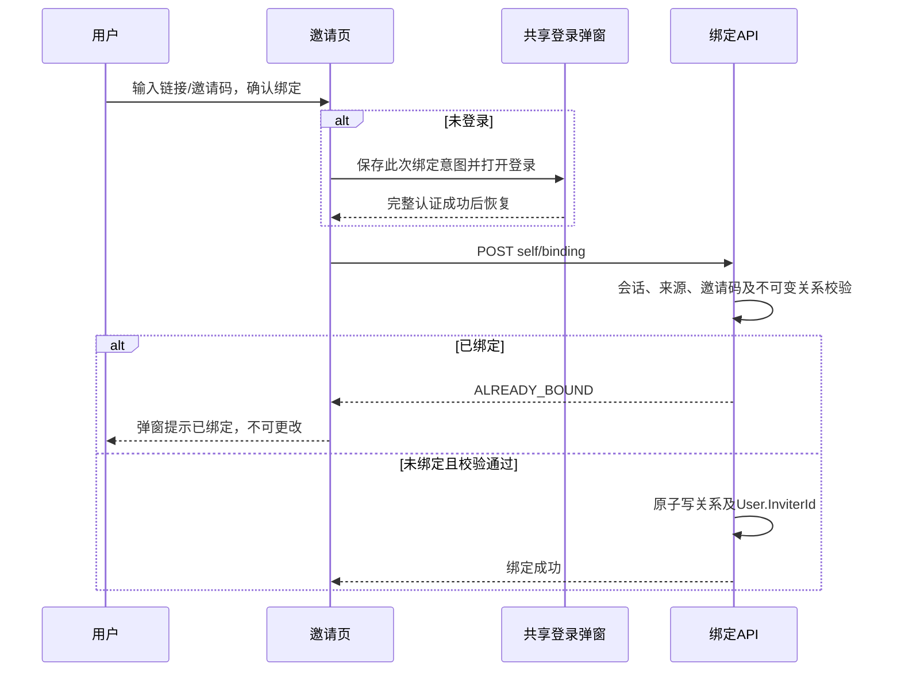

# 邀请好友活动详细设计

日期：2026-11-16。状态：待用户评审，尚未实施。

## 1. 目标、范围与已确认决策

在 new-api 实现演示页 `c-dev/ZYY-AI-demo.html` 的邀请好友功能，并加入后台可配置活动。用户已确认：

1. 仅订阅购买、续订参与返奖，普通余额充值不参与。
2. 仅冻结邀请人获得的奖励；购买者的订阅积分支付成功后立即可用。
3. 每一期活动统一配置阶梯，按各邀请人的有效好友数匹配，不提供个人专属规则。
4. 活动奖励类型可以选择通用积分或数据库中其他积分类型；冻结周期默认7天、活动可调整。
5. 确认绑定时未登录则打开登录弹窗，已登录则按输入绑定；已经绑定必须弹窗提示，不覆盖关系。

以下为依据演示页提出、随本设计一并评审的产品规则：有效好友跨活动累计，首笔有效订阅满7×24小时且未全额退款计一次；支付时锁定阶梯；补绑不追溯历史支付；上线不追补历史奖励；已释放奖励的退款转人工复核。示例阶梯0/3/9人对应5%/7%/10%，管理员可以改阈值与比例，不硬编码演示页50%/70%/100%的比例关系。

本期接入现有自定义订阅订单 `CustomSubscriptionOrder` 的真实支付成功路径，包括用户主动发起的再次购买/续订（每次创建新订单并经同一入口验签结算，当前order_type仍可为purchase）。旧版上游 subscription/quota 订单、人工赠送和充值不混入新返奖。现有真实自动扣款功能尚未开放，本期不新增自动扣款；未来真实续费订单必须经过同一支付结算入口，赠送部分仍不返奖。旧版订阅订单排除是本设计的边界。

## 2. 演示页功能映射

| 功能 | 生产行为 |
| --- | --- |
| 桌面及移动端邀请入口 | 公共 `/invite` 页面，接入现有公共/登录后顶栏；不加载演示页整段脚本 |
| 当前活动卡 | 名称、期数、时间、状态、奖励积分类型、阶梯、冻结时间均读后台配置 |
| 全部活动 | 弹窗展示未开始/进行中/已结束，真实分页，默认10条；无活动展示真实空状态 |
| 分享链接和邀请码 | 登录后使用真实 AffCode；复制反馈、失败提示；未登录打开共享登录弹窗 |
| 奖励概览 | 按积分类型展示累计到账、待释放、已取消；另列已绑定、待有效和有效好友人数 |
| 阶梯进度 | 当前有效人数、当前比例、下一档还差人数；最高档显示已达最高档 |
| 我的好友 | 展示直接好友的脱敏标识、是否有效、订阅订单、有效实付、释放时间、待释放/到账积分 |
| 奖励结算记录 | 活动/版本、订单展示号、锁定人数/比例、积分类型、冻结/释放/取消金额及状态 |
| 查看全部 | 两个列表各自分页，不复刻演示页当前隐藏且没有实际分页的按钮 |
| 我的邀请人 | 匿名可输入；已绑定只读；重复绑定弹窗；确认后终身锁定 |
| 完整规则 | 展示结构化配置生成的财务规则和后台说明；教程同步，禁止硬编码GPT、7天、固定档位 |
| 历史规则 | 历史订单按快照展示；不导入演示页虚构的legacy/stage-v1数据 |

邀请页“累计到账”包含已消费部分，不等于当前余额。不同积分类型不合并成可兑换现金的金额。钱包保留现有GENERAL/GPT总额契约，新增其他类型以独立余额卡呈现；冻结与调用预占分开展示。

## 3. 方案与边界

| 方案 | 取舍 |
| --- | --- |
| 复用旧 AffQuota/AffCount | 无法表达积分类型、订单快照、退款及冻结；旧 AffCount 是注册人数。排除 |
| 支付事务同步给邀请人入账 | 即时，但扩展到邀请人账户锁，奖励故障直接影响购买者结算；不推荐 |
| 支付事务锁定奖励快照，主库持久事件异步入账 | 购买者支付与事件原子提交，邀请人入账可重试，复用现有积分账本；推荐 |

采用第三种作为技术建议。后台事件任务属于本项目的专用数据库任务，不引入MQ或新运行时依赖。Redis仅可优化唤醒，不能拥有奖励事实。选择奖励异步处理意味着支付成功后短暂显示“奖励处理中”，不能伪装成已到账。

## 4. 活动配置及版本

后台新增“邀请活动”，使用现有管理员路由、侧栏、表格和表单模式。管理员可新建草稿、预览奖励、发布、复制新一期、提前结束、查看奖励/处理异常。页面显示待释放积分及受影响订单数量。沿用现有支付合规确认门禁，配置失效时禁止新增/发布活动；已经完成支付的奖励仍需结算，不因后台门禁变化吞掉用户权益。

字段：code（唯一）、period、name、description、starts_at、ends_at、reward_point_type_id、freeze_days（默认7，建议整数1–365）、tiers（阈值与比例）、rules_text、visible、version、状态及创建/发布人。

- 时间以Unix毫秒存储，界面标明时区；区间为 `[starts_at, ends_at)`。
- 只允许一个已发布有效活动覆盖任意时刻，发布/调整时在数据库串行校验区间，不能仅在前端判断重叠。
- 草稿不参与返奖。暂停/提前结束仅停止新支付匹配，已经生成的事件和冻结奖励继续处理。
- 发布形成经济内容不可变版本。修改奖励类型、阶梯、周期等经济规则必须发布新版本。另增invitation_campaign_activations保存version_id/effective_from/ended_at；激活时写一行，提前结束只将NULL的ended_at设置为当前或未来时间并记录审计，不能回填过去。版本中的原始计划区间和经济快照不变；支付按计划区间与activation结束时间的交集匹配，新版本最早从旧版本生效结束点开始。
- 管理员更新携带expected_version，冲突后刷新确认，不覆盖其他人的修改。
- 阶梯以min_effective_friends递增，从0开始；至少1档、最多20档；阈值唯一非负；rate_bps为0–10000整数，比例非递减。100bps=1%，支持0.01%精度。
- 积分类型来自现有point_types；发布时校验存在且有可使用的模型规则，并展示用途；不新增虚构的类型创建接口。上线后不得物理删除被历史订单引用的类型。
- 活动结束、隐藏、规则修改都不删除已经锁定的奖励资格。

示例：min=0/rate=500、min=3/rate=700、min=9/rate=1000；freeze_days=7；类型可选GPT或GENERAL。

## 5. 计算与有效好友

实付金额使用订单已校验的CNY分，积分按现有1元=1000积分折算。只算现金实付，不用套餐总积分、年付优惠、赠送或邀请奖励作为基数。

```text
net_paid_minor = amount_paid_minor - refunded_amount_minor
reward_points = floor(net_paid_minor × rate_bps × 1000 / (100 × 10000))
              = floor(net_paid_minor × rate_bps / 1000)
```

中间乘法用math/big或checked decimal，最后严格转换int64；负数、超额退款、溢出都拒绝，不转float。小于1积分的结果保留零奖励记录，不创建零值冻结/账本。

示例：实付100元，5%得到5000积分，7%得到7000积分，10%得到10000积分。100元按7%锁定后退30元，奖励目标变4900，累计取消2100。多次退款每次用累计退款重算目标后取差，避免逐笔舍入累计误差。

有效好友采用独立统计，不复用users.aff_count：

- 每个直接好友只计一次，跨月份、活动保留，不形成下级分销。
- 绑定后的首笔符合范围的订阅，在支付满固定7×24小时且仍有有效实付后成为候选；首次订单全退则按paid_at ASC、order_id ASC寻找后续满足条件的订单，切换candidate_order_id及eligible_at；相同成熟时间按order_id稳定排序。部分退款但净实付大于0仍有效；PREPARED退款候选暂不确认，完成或取消后重新计算。
- 固定7天是有效好友确认周期；活动freeze_days仅决定奖励何时释放。两者分离，避免某一期改为1天就改变累计人数口径。
- 已确认人数按演示页不因后续退款自动降低；异常交易可人工复核，不能静默改历史比例。
- 第3位好友首单支付时只有2位有效好友，该单仍5%；确认其有效后，之后支付订单才7%。同一好友复购不增加人数。
- 支付快照前在同一串行边界内确认所有到期候选，统计到该次结算时刻，不能因后台任务晚跑导致低档锁定。
- 当没有活动时，范围内的订阅仍可形成有效好友候选，用于之后活动累计，但不生成奖励。历史上线前订单不自动计入。
- 确认使用逻辑生效时间，不以worker实际运行时间为准。退款prepare/complete/cancel事务在同一control锁内先补算到该事件时间的到期资格，再应用事件；保存各操作prepared_at/completed_at/cancelled_at以供核对。第7天成熟、第8天才登记全退，即使worker停到第9天，也先按第7天有效状态确认，人数保留。若第6天已prepare，第7天处于hold，则暂不确认；第8天cancel或部分退款完成且净实付>0时，从第8天确认，全退则切换候选。人工事后补报不倒签重算旧阶梯，进入异常复核。支付快照与批处理均使用同一资格reconcile逻辑。

## 6. 数据模型（均在主库）

字段和命名为拟新增契约，实施时遵循GORM与三数据库兼容要求。

| 表 | 核心字段/约束 |
| --- | --- |
| invitation_control | 单行id=1、revision；协调发布、绑定、支付快照、资格确认与退款状态变更 |
| invitation_campaigns | code唯一，期数、标题、状态、visible、当前版本、审计时间 |
| invitation_campaign_versions | campaign_id/version唯一；生效起止、point_type_id、freeze_days、规则快照 |
| invitation_campaign_activations | version_id、effective_from、ended_at；区间变动审计，经济版本内容不改 |
| invitation_campaign_tiers | version_id/min_effective_friends唯一；rate_bps |
| invitation_bindings | invitee_id唯一、inviter_id、bound_at、source、原邀请码快照；inviter_id索引 |
| invitation_qualifications | invitee_id唯一、inviter_id、candidate_order_id、eligible_at、qualified_at可空、状态；到期索引 |
| invitation_rewards | business_type/order_id唯一；inviter/invitee、campaign_version_id、支付时金额/人数/比例/类型/周期快照、paid_at、release_at、original/cancelled/released/frozen points、freeze_id及状态 |
| invitation_events | event_key唯一、reward/order/refund引用、类型、payload_hash、pending/done/failed、attempts、next_retry_at、last_error_code |
| invitation_refund_operations | order_id/request_id唯一、provider/refund唯一、请求/实际退款分、状态、证据摘要 |
| invitation_audit_logs | 绑定/活动发布结束/退款登记/人工冲回的操作人、对象、前后版本、request_id；不含认证秘密 |

复用point_accounts、point_transactions、point_ledger、point_freezes。奖励的release_at放在invitation_rewards，不把其他业务冻结误判为定时冻结。通过freeze_id明确一笔奖励拥有的冻结，不允许按账户总冻结额释放。

金额不变量：`original_points = cancelled_points + processing_points + frozen_points + released_points`；`net_released_points = released_points - reversed_points`。各项非负，reversed不超过released；released是历史累计，退款后不通过修改released伪造从未到账。已释放退款需要追回但尚未执行的金额另存review_due_points，不重复计入cancelled。reversed_points、review_due_points在reward持久化，并与专用操作及账本核对。

invitation_rewards状态建议CAPTURED（快照已提交）、FROZEN、RELEASED、CANCELLED、REVIEW_REQUIRED。部分取消保留FROZEN并记录cancelled_points，不用单个状态替代金额。failed事件可以重试，不直接等价于奖励取消。invitation_refund_operations另存order_id、request_id、provider_refund_id、requested/actual_amount_minor、PREPARED/SUCCEEDED/CANCELLED状态及证据摘要；按order/request和provider/refund建立唯一键。

关系迁移：已有非零users.inviter_id迁移为source=legacy的不可变关系；bound_at无法证明则保留NULL，不猜时间；上线前订单不补奖。新绑定同步写User.InviterId及binding，作为兼容投影；所有可修改InviterId的后台/注册入口必须审计并禁止绕过不可变约束。不能只给新API加锁却允许旧用户编辑接口改关系。历史循环/自邀/失效引用生成报告，先阻止其新奖励，不能擅自重绑或抹去历史关系。

## 7. 事务、快照与异步处理

### 7.1 一致性边界

第一版采用主库单行invitation_control协调相关业务变更。通过实际UPDATE revision取得写入顺序，SQLite也执行写锁；MySQL/PostgreSQL用共享lockForUpdate辅助。进程内mutex及Redis锁不能替代。

新增订阅结算包装入口先锁control，再进入现有customSubscriptionTransaction，之后保持schedule→order→payment→购买者积分账户的现有顺序。需要为现有调度事务增加接收同一外层tx的内部入口，不能先独立commit再捕获奖励，也不能把外层tx丢弃后调用使用全局DB的新事务。资格/绑定/活动变更也先锁control；异步奖励任务按control→reward/event→邀请人账户→自有freeze顺序。查询列表不锁control。任何旧路径不得先锁积分账户再回头取control；重试必须重启完整事务，不能在失败的PostgreSQL事务内继续查询。

这样可避免“先锁购买者，再锁邀请人”的A邀B、B邀A死锁，也为同一时刻活动切换、好友有效、支付提供明确顺序。代价是邀请相关写事务短时串行，实施需测试批量资格确认的锁耗时与支付吞吐。超出预算时先暂停发布/优化批次，再另行设计按邀请人分片，不声称此方案无限扩展。事务内不进行外部网络请求。

### 7.2 支付捕获

真实支付仍先由现有入口验签并校验商户、订单用途、金额、支付方法及支付流水；前端支付跳转不能发奖。现有购买者积分、quota兼容账、订单和订阅权益仍原子提交。

在同一主库事务内：

1. 确认绑定已存在且不是自邀/失效引用，绑定生效先于本次支付结算；不存在则记录无返奖结果。
2. 在control保护下处理到期有效好友，读取此刻人数，按当前已发布版本及时间选择唯一档位。
3. 写唯一reward快照及唯一CAPTURE事件；无活动只保留资格候选。邀请人积分账户此时不写。
4. 提交后按现有逻辑同步购买者缓存；通知专用任务处理奖励。捕获写失败则整个支付事务回滚并由现有回调重试，不能返回成功并丢事件。

支付时间统一使用首次成功数据库结算的服务器时间，与现有order.paid_at一致，不信任客户端时间。晚到的验签回调按首次成功结算时有效活动处理，不倒查第三方时间重算；该取舍需在活动规则明确。重复回调读取已保存结果，包括“无活动/无邀请人”结果，不能后来补绑或开活动后重新生成奖励。建议在订阅订单增加nullable invitation_capture_version/结果标记，区分已处理、上线前记录和待捕获，唯一性不能仅靠有奖励时存在的reward行。

### 7.3 冻结入账

后台读取事件后逐笔主库事务处理。唯一积分event key例如`invite:<reward_id>:credit`，CREDIT动作直接增加frozen而非available，创建reason=INVITATION_REWARD的PointFreeze及ledger，关联reward，原子置done。中途失败全部回滚；成功后崩溃重跑凭事件及唯一账本键返回已完成。

CAPTURED即展示待处理资格，不能伪装成已经计入point_accounts的冻结余额。邀请页pending总量可含CAPTURED和FROZEN，但分出processing_points；钱包frozen仅展示真实冻结，另显示处理中的奖励，避免重复计数。

### 7.4 定时释放

每30秒扫描，启动时立即补跑，批次100，有限重试及退避；指标展示延迟。释放语义为到期后自动处理，正常目标60秒内，不承诺毫秒级到账。节点启动模式可以沿用master task，但多实例最终安全由数据库保证。

到期事务锁reward、所属账户和freeze，确认状态与剩余额度匹配，只释放自有remaining_points：available+=remaining，frozen-=remaining；写UNFREEZE transaction/ledger，关闭freeze并置RELEASED。event key固定`invite:<id>:release`。账户允许现有负可用余额，释放按正常加法抵减债务；不对外承诺一定增加可消费额度。账户版本与溢出均检查。停机跨过期限的奖励恢复后补释放；若捕获事件此时才入账，先持久化冻结账再同轮释放，保留完整轨迹。

### 7.5 退款与人工复核

现有RefundStatus字段不等于现成退款服务。本期新增session-admin退款操作资源：先prepare登记请求和计划退款金额，再由操作员/外部系统执行渠道退款，最后complete登记已核实的provider/refund_id和实际金额；渠道失败或取消时执行cancel。request_id幂等，重复相同载荷返回当前状态，不同载荷冲突；SUCCEEDED不能cancel。允许重试未完成操作，超时只告警、不自动当作失败放行释放。不直接调用支付提供方。

在退款提供方操作前应先登记退款处理中并阻止对应奖励释放；退款完成再在主库事务同步订单退款累计、资格状态及奖励目标；失败cancel后清除对应hold，只有不存在其他PREPARED操作才恢复释放。已知事后退款允许直接登记complete并走对应状态复核，不能伪造prepare发生在过去。若从其他系统直接退款但未登记，系统无法即时自动知道，必须告警/对账，不能宣称已保证所有外部退款自动冲回。

- CAPTURED：更新净奖励，后续仅按净额入冻，保留原始/取消数。worker必须在相同锁边界重读reward当前目标，不按旧事件载荷发放。事件payload_hash只标识初次事件，退款是单独事件，不能误报为初始载荷冲突。零目标直接完成事件并置CANCELLED，不创建账户、freeze或零值账本；入冻前取消只写业务审计，不伪造积分流水。
- FROZEN：按累计退款重算，扣减owned freeze及frozen；写REVOKE账本，不能先释放再扣，也不动调用预占。
- 全退且未释放：CANCELLED，关闭自有freeze；不得计入有效好友。
- RELEASED：REVIEW_REQUIRED，列出需冲回数；客服使用带reward引用、幂等键和理由的专用管理员冲回操作，可产生负available，不能要求回收调用/其他业务冻结。每次冲回仍走账户版本、账本和权限检查。此路径不得阻止依法核实的现金退款。
- 释放与退款使用相同control/reward锁排序；先得到锁的事务确定状态，后者重新读状态并走对应分支。已经确认有效好友不自动减人数，按规则人工处理异常。

## 8. 邀请绑定及登录恢复



- 只接受完整本平台链接中的`aff`（兼容旧/sign-up?aff）或`ref`（兼容演示页），以及直接邀请码；URL仅解析，不访问。外域、协议异常、重复/冲突参数、空值、控制字符、超过2048字符拒绝。
- 邀请码大小写按现有库真实语义匹配，不擅自大写破坏旧链接；正式迁移需检测现有码在各数据库排序规则下的冲突。
- 未登录点击保存独立的pending binding intent（code、随机request_id、创建时间，建议sessionStorage有效30分钟）并打开现有modal，不能只依赖登录成功会清理的注册affiliate storage。
- 新账号若注册时已经由相同代码归因，恢复后读取当前关系并提示已绑定；注册奖励不能重复触发。老账号只有此次显式绑定动作才可以补绑，普通登录、GET访问、页面预加载不绑定。
- 取消登录不发绑定请求；MFA/微信后手机绑定未完成不恢复；完成后再次二次确认不可更改。页面销毁后回到/invite恢复需重新确认，禁止后台静默提交；账号切换后丢弃上个账号已确认意图，重新确认。
- 已登录点击：前端展示不可更改确认，服务器才决定是否可绑；绑定成功刷新referrer/summary，禁用重复提交；ALREADY_BOUND无论相同/不同目标均弹窗。
- 后端取session user，不接受invitee_id；检查邀请人存在且可用、非本人，阻止循环邀请链。control串行关系更新，遍历邀请链防止A/B同时互绑或长环；历史坏链失败关闭并报内部诊断，不能任意截断后接受。
- 一生一次，只有CAS `inviter_id=0` 加invitee唯一约束才写；事务同步关系与兼容字段。补绑不追加旧注册赠送、不改旧注册计数，新增邀请统计独立查询关系。
- 历史非零inviter_id即已绑定，不因邀请人停用、删除或资料隐藏而允许换绑；用户只看到脱敏状态。
- 会话API检查UserAuth、同源/CSRF、限流，PAT不可调用。邀请码仅是归因输入，不是登录或授权凭据。现有认证、MFA、短信证明生命周期不放宽。

## 9. 拟新增API及数据契约

统一`{success,message,data}`，错误用稳定业务code并映射七语言；不能依靠中文message判断状态。ID、毫秒时间、金额、积分返回十进制字符串，比例bps为有界整数。分页p/page_size默认1/20、最大100，拒绝未知/重复/非法参数；不泄露提供方载荷、真实手机号、支付流水或完整账号资料。

| API（建议命名） | 权限/用途 |
| --- | --- |
| GET /api/invitation/campaigns/current | 公共；无活动data=null，真实失败返回错误 |
| GET /api/invitation/campaigns | 公共；可见历史/未来活动分页 |
| GET /api/invitation/self/summary | session；有效/待确认人数、当前/下一档、按类型奖励汇总及处理状态 |
| GET /api/invitation/self/link | session；复用邀请码，返回本平台链接 |
| GET /api/invitation/self/binding | session；本人绑定状态及脱敏邀请人 |
| POST /api/invitation/self/binding | session+限流+CSRF；{invitation,request_id}，不可变绑定 |
| GET /api/invitation/self/friends | session；本人直接好友分页，可展开受限订单投影 |
| GET /api/invitation/self/rewards | session；本人奖励分页、活动/状态/积分类型筛选 |
| GET/POST /api/invitation/admin/campaigns | session admin；列表/创建草稿 |
| GET/PUT /api/invitation/admin/campaigns/:id | session admin；详情/expected_version更新 |
| POST /api/invitation/admin/campaigns/:id/publish 或 /end | session admin；不可变版本发布/提前结束 |
| GET /api/invitation/admin/rewards | session admin；异常、待释放及审计 |
| POST /api/invitation/admin/orders/:id/refunds | session admin；创建prepare资源，request_id幂等，非现金退款执行器 |
| POST /api/invitation/admin/orders/:id/refunds/:refund_id/complete 或 /cancel | session admin；确认已核实的渠道结果/取消hold，验证订单及退款归属 |
| POST /api/invitation/admin/rewards/:id/reversal | session admin；已释放奖励人工冲回，request_id、理由、证据引用 |

上述均为拟新增路由，实施前登记PAT路由目录及管理员策略，不能声称已存在。summary返回每种point_type_id的released_total、pending_total、processing_points、cancelled_total、reversed_total；到期时间以release_at为准，客户端不能自行支付时间+固定7天。

错误码建议INVALID_INVITATION、SELF_INVITATION、INVITATION_CYCLE、ALREADY_BOUND、CAMPAIGN_VERSION_CONFLICT、CAMPAIGN_OVERLAP、POINT_TYPE_UNAVAILABLE、REFUND_CONFLICT、REWARD_REVIEW_REQUIRED。数据库故障返回安全错误及内部诊断，不能伪造成功或零统计。

## 10. 兼容、迁移与运维

- 新表及订单capture标记为增量迁移，主库登记，日志库不迁移财务表；SQLite、MySQL>=5.7.8、PostgreSQL>=9.6均支持，不依赖SKIP LOCKED、partial index或JSON操作符。
- fresh和代表性现有库升级各跑两次，验证唯一约束、NULL、长整型和既有数据；迁移旧关系不改旧AffQuota、AffHistory、AffCount，不将quota兑换为新积分。
- 活动默认无发布记录，不自动启用演示活动。先部署schema和任务，再管理员检查迁移报告，配置草稿、验证类型和阶梯、发布未来起始活动。
- 旧邀请额度仍按旧钱包功能保留，邀请新页不把它当成新积分；教程、钱包pending_gpt_points:null占位需升级为真实按类型奖励读模型，保留兼容字段或显式版本化，不突然改变旧字段类型。
- 新UI查询键带viewer身份；切账号清缓存，绑定成功刷新相关查询；奖励后台处理无需依赖用户打开页面。
- 监控pending事件数、重试、最老事件年龄、到期未释放数/时间、积分与freeze不一致、control锁耗时、退款待复核数。不记录token/会话/短信凭证。
- 回滚先结束活动以停新奖励，再停止worker并核对冻结余额/待处理事件，使用能理解新财务记录的兼容版本；不要直接回滚到会丢capture事件的旧支付版本。保留表和快照，禁止回滚时删账或把所有冻结一次性解开。

## 11. 设计审阅与验证验收

2026-11-16完成独立builder审阅；已补齐同tx原语、人工续订入口、激活区间与经济版本分离、CAPTURED退款重读、退款prepare/complete/cancel、金额不变量及候选订单稳定排序。以下检查是实施要求，并非本轮已执行的业务测试。

1. 精确计算覆盖分、0积分、最大金额、超过2^53、溢出、重复及分次退款；5000/7000/10000示例一致。
2. 绑定覆盖匿名登录成功/取消/MFA/手机绑定、已有用户补绑、同码重放、异码竞争、自邀、循环、非法链接、已有历史关系、账号切换、预加载无写。
3. 活动覆盖区间边界、重叠并发发布、expected_version、关闭后旧奖励、变更类型/周期后的历史快照。
4. 支付覆盖回调验签与用途、普通topup/旧subscription排除、购买者立即可用、重复/晚回调、无活动结果幂等、补绑前订单不补奖、事件写失败整单回滚。
5. 资格覆盖跨活动、同好友复购、首单全退/后单有效、确认边界、任务延迟及发布/付款/资格同时发生。
6. 账户覆盖冻结不可调用、不动调用hold/管理员冻结、available负数、版本冲突、worker崩溃和多实例；捕获/入冻/释放每一步重放无重复积分。
7. 退款覆盖CAPTURED/FROZEN/RELEASED、部分/全额、退款处理中与释放竞争、同退款键变载荷拒绝、人工冲回审计。
8. 三种真实数据库执行迁移及并发矩阵，记录精确版本和结果。没有实例就报告阻塞，不能以SQLite测试代替全部数据库兼容。
9. 前端Vitest交互及精确数字、错误/空态、七语言；typecheck/lint/build；Chrome验证桌面/移动端及登录恢复、键盘操作、分页、长邀请码和多积分类型。

本文件仅说明拟实现能力；未执行迁移、真实支付或业务测试，不作数据库兼容和安全合规已验证声明。
